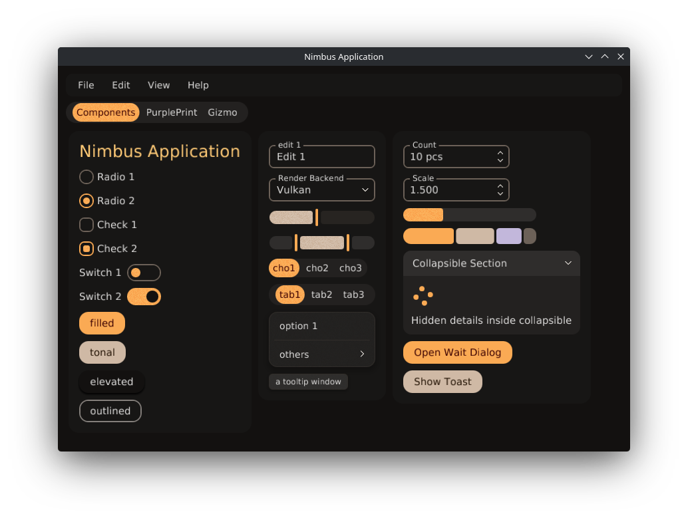
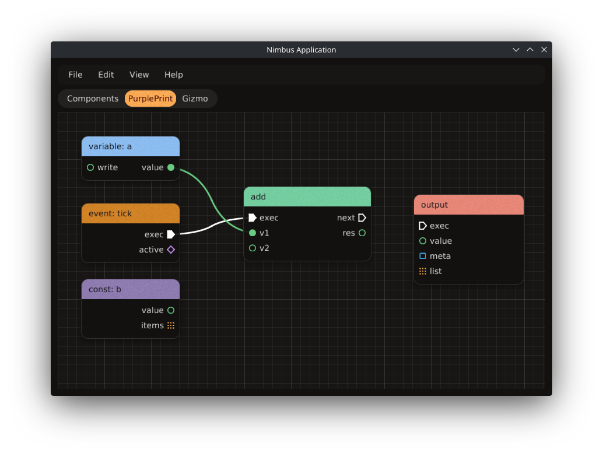
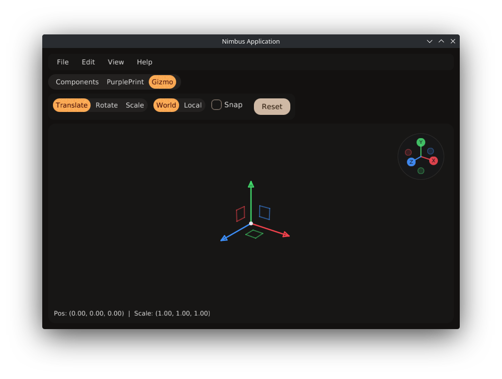
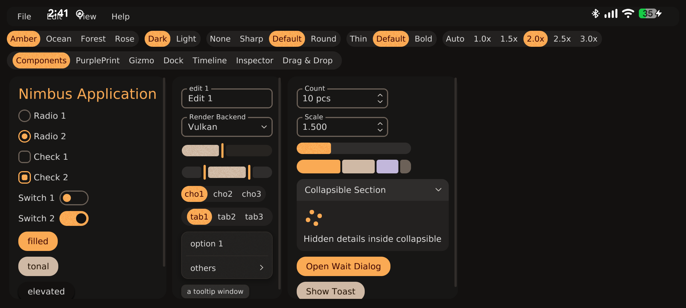

# Nimbus

A Rust UI framework and 2D engine developed under QAOS. Nimbus brings together a declarative markup language (**QDL**), a Vulkan-based 2D renderer, dynamic Material 3 / Monet theming, and spring animations for desktop and Android.

Other languages: [tr](README.tr.md)

---

## Features

- **2D Renderer:** Vulkan 1.1+ rendering for desktop and Android, with HiDPI scaling and font atlas text rendering.
- **Declarative UI (QDL):** Simple markup for defining layouts, styles, and callbacks.
- **Dynamic Theming:** Material 3 / Monet tonal palettes with light and dark mode support.
- **Animations & Input:** Spring and easing animations, touch scrolling with stretch overscroll, drag & drop, and OS cursor support.
- **Components (`nimbus_ui`):**
  - **Inputs & Controls:** `Button`, `Check`, `Radio`, `Switch`, `Slider`, `Interval`, `SpinBox`, `FloatSpinBox`, `Edit`, `ComboBox`, `DragSource`, `DropZone`.
  - **Navigation & Data:** `Tabs`, `Choice`, `MenuBar`, `Popup`, `TreeView`, `Collapsible`.
  - **Feedback & Display:** `Text`, `ProgressBar`, `MultiProgressBar`, `Spinner`, `Tooltip`, `Dialog`, `Toast`.
  - **Layout & Containers:** `HBox`, `VBox`, `Flow`, `Stack`, `Card`, `ScrollView`, `Spacer`, `Viewport`.
- **Extensions:** Optional crates for docking (`nimbus_ui_dock`), property inspection (`nimbus_ui_inspector`), timelines (`nimbus_ui_timeline`), 3D gizmos (`nimbus_ui_gizmo`), and node graphs (`nimbus_ui_purple_print`).

---

## Running the Demo

Desktop:

```bash
cargo run --example demo
```

Android (requires Android SDK/NDK and `cargo-ndk`):

```bash
cd examples/demo_android && ./build_apk.sh
```

---

## Visuals


*General UI demo.*


*PurplePrint node graph.*


*3D gizmo.*

### Test on Android


*Android demo.*

---

## License

This project is licensed under the GNU General Public License version 3 (GPL3).

Copyright (c) 2025-2026 Kadir Aydın.

---

## QAOS

Built with ❤️ by the open-source community.
