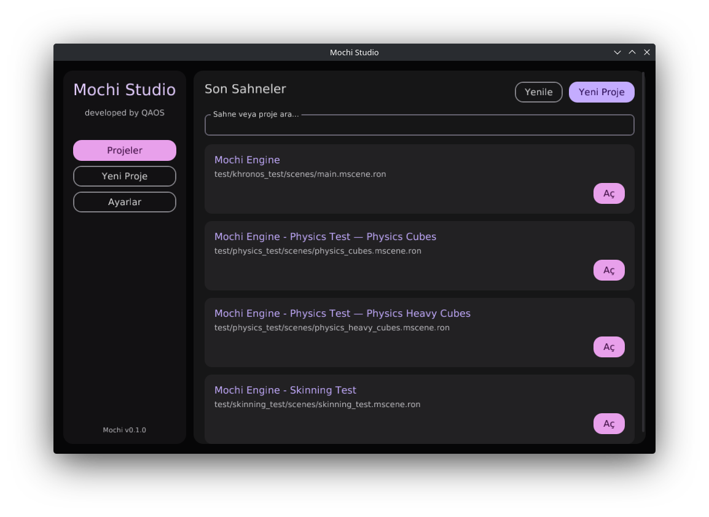
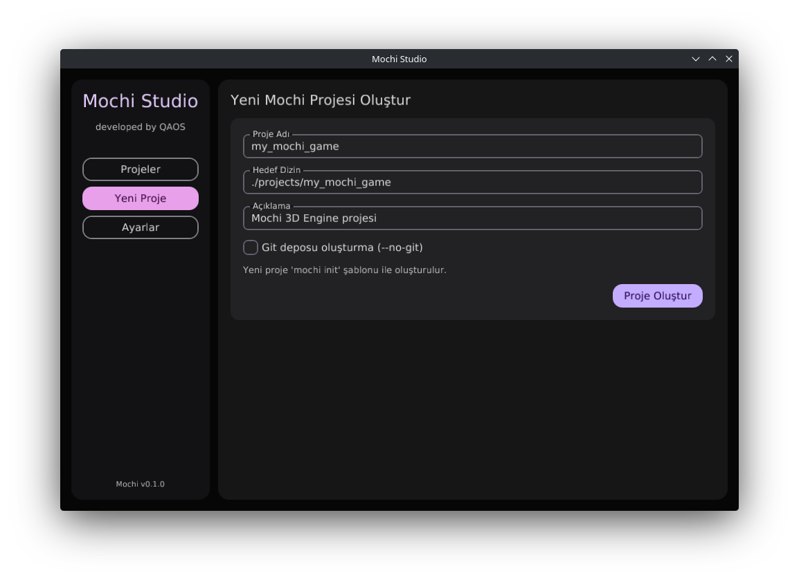
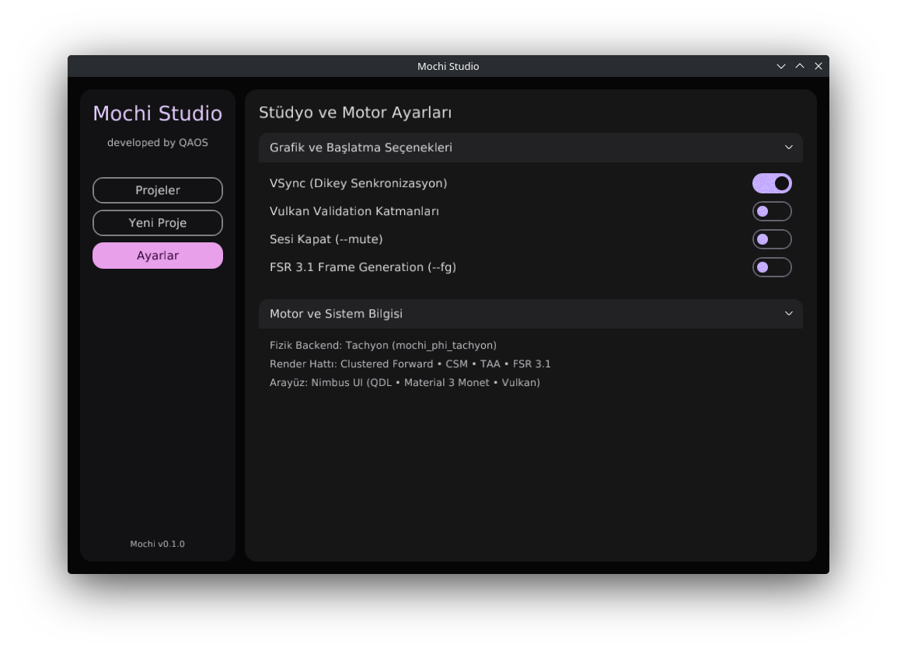

# Nimbus

Saf Rust ile geliştirilmiş GPU hızlandırmalı bir kullanıcı arayüzü (UI) motoru ve iskeleti.

QAOS çatısı altında geliştirilen Nimbus; bildirimsel bir arayüz dili (**QDL**), Vulkan tabanlı 2D render hattı, Material Design 3 / Monet dinamik renk paleti ve fizik tabanlı interaktif yay animasyonlarını bir araya getirir.

Diğer diller: [en](README.md)

---

## Özellikler

- **GPU Hızlandırmalı 2D Render Motoru:** Vulkan (`nimbus_rhi_ash`) üzerinde çalışan, GPU prosedürel noise gölgelendiricileri (shaders) ve yüksek kaliteli font atlası (`fontdue`) içeren 2D çizim motoru.
- **Bildirimsel QDL Biçimlendirmesi:** Arayüz hiyerarşisini, stilleri ve olay bağlamalarını kolayca tanımlayan insan dostu arayüz işaretleme dili.
- **Dinamik Tema (Material 3 / Monet):** OKLCH tabanlı dinamik ton paletleri, yükseklik (elevation) belirteçleri, yarıçap ve çizgi stilleri ile tam açık/koyu tema desteği.
- **Yay Animasyonları:** Hızlı ve tepkisel yay fiziği (`Spring::INTERACTIVE`, `BOUNCY`, `SMOOTH`) ve yumuşak geçiş eğrileri (`EmphasizedDecelerate` vb.).
- **Bileşen Kütüphanesi (`nimbus_ui`):**
  - **Girdi & Kontroller:** Düğmeler (`Button` - Filled, Tonal, Elevated, Outlined), Onay Kutusu (`Check`), Radyo Düğmesi (`Radio`), Anahtar (`Switch`), Kaydırıcı (`Slider`), Aralık Kaydırıcı (`Interval`), Metin Girişi (`Edit`).
  - **Gezinme & Seçim:** Sekmeler (`Tabs`), Seçenek Çipleri (`Choice`), Açılır Menüler (`Popup` - animasyonlu alt menüler ve özel yön okları ile).
  - **Geribildirim & Göstergeler:** İlerleme Çubuğu (`ProgressBar`), Çoklu İlerleme Çubuğu (`MultiProgressBar`), İpucu Kutusu (`Tooltip` / `ToolTip` - yön konumlandırması ve yumuşak kayma animasyonları ile).
  - **Düzen & Konteynerler:** Yatay Kutu (`HBox`), Dikey Kutu (`VBox`), Akış Düzeni (`Flow`), Kart (`Card`), Kaydırılabilir Alan (`ScrollView`).

---

## Görseller

*Arayüz testi.*

#### Örnek Uygulamalar

*Arayüz testi.*

*Arayüz testi.*

*Arayüz testi.*

---

## Lisans

Bu proje GNU Genel Kamu Lisansı sürüm 3 (GPL3) altında lisanslanmıştır.

Telif Hakkı (c) 2025-2026 Kadir Aydın.

---

## QAOS

Açık kaynak topluluğu tarafından ❤️ ile geliştirilmiştir.
