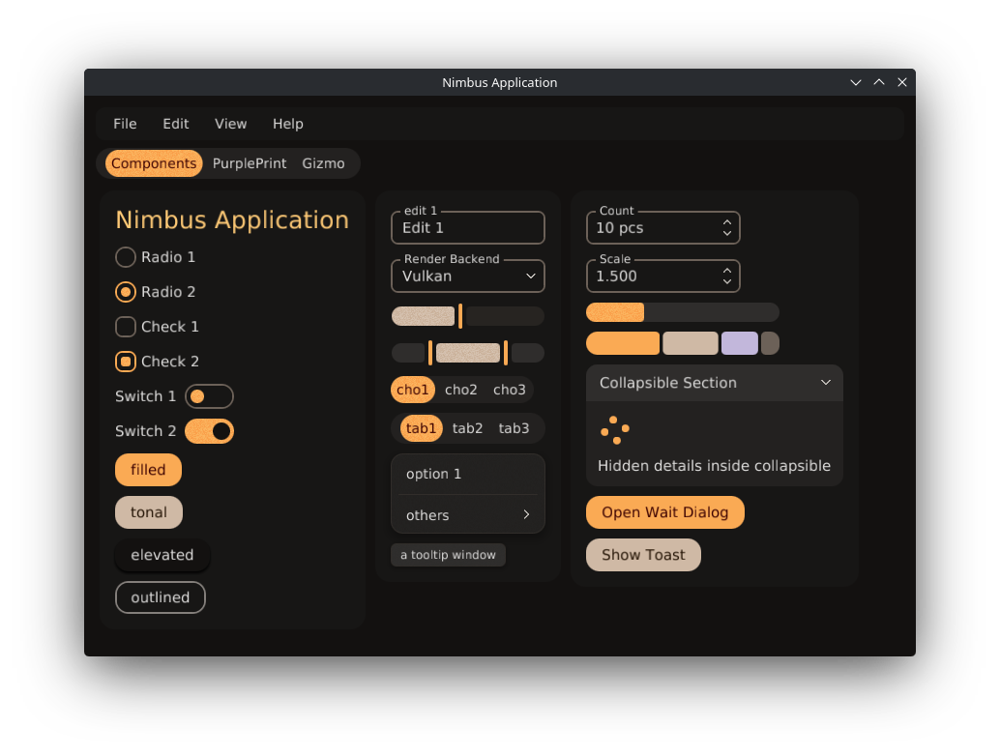
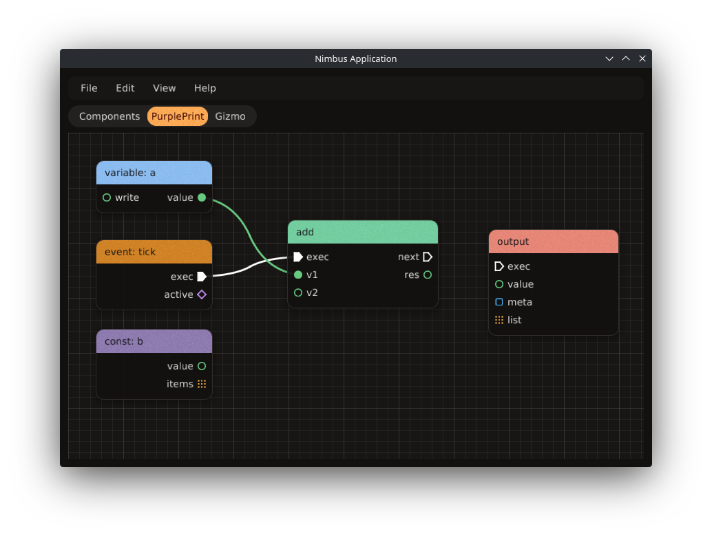
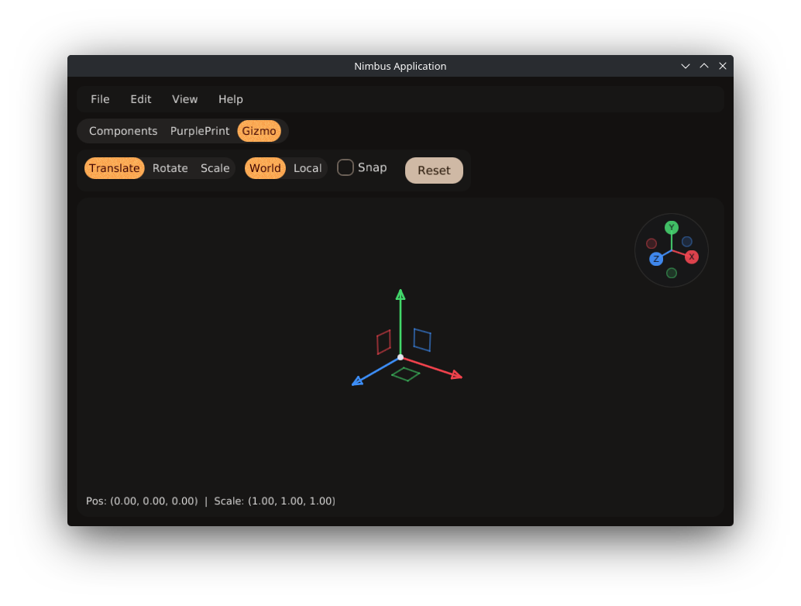
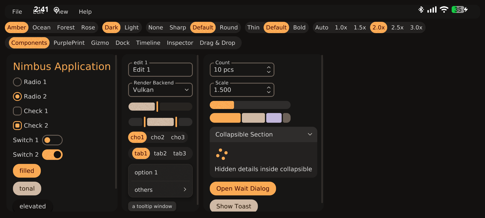

# Nimbus

QAOS çatısı altında Rust ile geliştirilen bir kullanıcı arayüzü (UI) iskeleti ve 2D motoru. Bildirimsel bir arayüz dili (**QDL**), Vulkan tabanlı 2D çizim motoru, dinamik Material 3 / Monet tema sistemi ve yay animasyonlarını masaüstü ile Android için bir araya getirir.

Diğer diller: [en](README.md)

---

## Özellikler

- **2D Çizim Motoru:** Masaüstü ve Android için Vulkan 1.1+ desteği, HiDPI ölçekleme ve font atlası ile metin çizimi.
- **Bildirimsel Arayüz (QDL):** Yerleşim, stil ve olay bağlamalarını tanımlamak için sade bir işaretleme dili.
- **Dinamik Tema:** Açık ve koyu mod destekli Material 3 / Monet renk paletleri.
- **Animasyon & Girdi:** Yay ve geçiş eğrisi animasyonları, esneyen overscroll ile dokunmatik kaydırma, sürükle-bırak ve işletim sistemi imleç desteği.
- **Bileşenler (`nimbus_ui`):**
  - **Girdi & Kontroller:** `Button`, `Check`, `Radio`, `Switch`, `Slider`, `Interval`, `SpinBox`, `FloatSpinBox`, `Edit`, `ComboBox`, `DragSource`, `DropZone`.
  - **Gezinme & Veri:** `Tabs`, `Choice`, `MenuBar`, `Popup`, `TreeView`, `Collapsible`.
  - **Geribildirim & Gösterim:** `Text`, `ProgressBar`, `MultiProgressBar`, `Spinner`, `Tooltip`, `Dialog`, `Toast`.
  - **Düzen & Konteynerler:** `HBox`, `VBox`, `Flow`, `Stack`, `Card`, `ScrollView`, `Spacer`, `Viewport`.
- **Eklentiler:** Yerleşim pencereleri (`nimbus_ui_dock`), özellik denetçisi (`nimbus_ui_inspector`), zaman çizelgesi (`nimbus_ui_timeline`), 3D gizmo (`nimbus_ui_gizmo`) ve düğüm grafiği (`nimbus_ui_purple_print`) için isteğe bağlı paketler.

---

## Demoyu Çalıştırma

Masaüstü:

```bash
cargo run --example demo
```

Android (Android SDK/NDK ve `cargo-ndk` gerektirir):

```bash
cd examples/demo_android && ./build_apk.sh
```

---

## Görseller


*Genel arayüz demosu.*


*PurplePrint düğüm grafiği.*


*3D gizmo.*

### Android üzerinde test


*Android demosu.*

---

## Lisans

Bu proje GNU Genel Kamu Lisansı sürüm 3 (GPL3) altında lisanslanmıştır.

Telif Hakkı (c) 2025-2026 Kadir Aydın.

---

## QAOS

Açık kaynak topluluğu tarafından ❤️ ile geliştirilmiştir.
